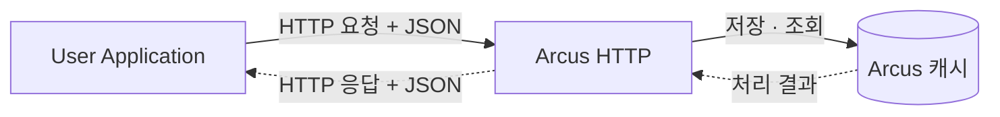

<h1 align="center">Arcus HTTP</h1>

<p align="center">
  Arcus 캐시를 HTTP API로 사용해 보세요.
</p>

<p align="center">
  <a href="https://jam2in.com/arcus-http/"><strong>OpenAPI 문서 ↗</strong></a>
  &nbsp; | &nbsp;
  <a href="#빠른-시작">빠른 시작</a>
</p>

---

Arcus HTTP는 Arcus 캐시 기능을 HTTP API로 제공하는 Spring Application입니다.

## 목차

- [사용 사례](#사용-사례)
- [요청 흐름](#요청-흐름)
- [지원 기능](#지원-기능)
- [빠른 시작](#빠른-시작)
- [설정](#설정)

## 사용 사례

- **Java 이외의 언어로 서비스를 개발할 때**: Python, Go, Node.js 등에서 HTTP 요청으로 Arcus 데이터를 저장하고 조회할 수 있습니다.
- **Arcus 연동을 빠르게 확인할 때**: Java 클라이언트 코드를 작성하지 않고 curl, Swagger UI로 요청을 보내볼 수 있습니다.
- **여러 언어의 서비스에 같은 캐시 API가 필요할 때**: KV와 컬렉션 연산을 공통된 JSON 요청과 응답 형식으로 사용할 수 있습니다.

## 요청 흐름

사용자 서비스가 HTTP로 요청을 보내면 Arcus HTTP가 이를 Arcus Java Client의 연산으로 실행하고 결과를 JSON으로 반환합니다.



## 지원 기능

값은 JSON 문자열, 숫자, 불리언, 객체와 배열을 지원합니다.

| 자료형    | 주요 기능                                                   |
|--------|---------------------------------------------------------|
| KV     | 저장과 조회, 조건부 저장, append/prepend, CAS 조회, 증감, TTL, bulk   |
| List   | 인덱스 기반 삽입, 범위 조회, 삭제, bulk, piped                       |
| Set    | 요소 삽입, 존재 확인, 조회, 삭제, bulk, piped                       |
| Map    | mKey 기반 삽입과 수정, 조회, 삭제, bulk, piped                     |
| B+Tree | 숫자/바이트 bKey, EFlag, 범위와 위치 조회, trim, smget, bulk, piped |
| Item   | 아이템 속성 조회와 변경                                           |
| Cache  | 전체 또는 prefix별 Flush                                     |

자료형별 요청과 응답은 [OpenAPI 문서](https://jam2in.com/arcus-http/)에서 확인할 수 있습니다.

## 빠른 시작

> [!NOTE]  
> 사용 가능한 Arcus 클러스터가 필요합니다.
> 클러스터 구성은 [naver/arcus - docker-compose.yml](https://github.com/naver/arcus/blob/master/docker-compose.yml)을 참고하세요.


Arcus HTTP는 [Docker Compose](#docker-compose로-실행하기) 또는 [Gradle](#gradle로-실행하기)로 실행할 수 있습니다.
어느 방법이든 Arcus HTTP에서 ZooKeeper와 ZooKeeper에 등록된 캐시 노드 주소에 접근할 수 있어야 합니다.

### Docker Compose로 실행하기

> [!WARNING]  
> 이 Compose는 `network_mode: host`를 사용합니다.
> **macOS/Windows에서 Docker Desktop을 사용하는 경우**, **Settings → Resources → Network → Enable host networking**을 활성화해야 합니다.   
> 자세한 내용은 [Docker 공식 안내](https://docs.docker.com/engine/network/drivers/host/#docker-desktop)를 참고하세요.

```sh
git clone https://github.com/jam2in/arcus-http.git
cd arcus-http
cp .env.example .env
```

`.env`의 ZooKeeper 주소와 서비스 코드를 기존 클러스터에 맞게 변경합니다.

```dotenv
ARCUS_ZOOKEEPER_ADDRESS=zk1.example.com:2181,zk2.example.com:2181,zk3.example.com:2181
ARCUS_SERVICE_CODE=test
```

다음 명령으로 Arcus HTTP를 실행합니다.

```sh
docker compose --env-file .env up --wait
```

준비가 끝나면 Arcus HTTP가 `http://localhost:49686`에서 요청을 받습니다.

```sh
# Arcus HTTP와 캐시 연결 상태를 확인합니다.
curl http://localhost:49686/actuator/health
```

### Gradle로 실행하기

**JDK 25**가 필요하며, Gradle은 포함된 Gradle Wrapper(`./gradlew`)를 사용하므로 별도로 설치하지 않아도 됩니다.

```sh
git clone https://github.com/jam2in/arcus-http.git
cd arcus-http
```

ZooKeeper 주소와 서비스 코드를 환경 변수로 지정하고 `bootRun`으로 실행합니다. 지정하지 않은 항목은 [기본값](#설정)을 사용합니다.

```sh
ARCUS_ZOOKEEPER_ADDRESS=zk1.example.com:2181,zk2.example.com:2181,zk3.example.com:2181 \
ARCUS_SERVICE_CODE=test \
./gradlew bootRun
```

준비가 끝나면 Docker Compose로 실행한 경우와 마찬가지로 `http://localhost:49686`에서 요청을 받습니다.

```sh
curl http://localhost:49686/actuator/health
```

### 값 저장하기

다음 예제는 JSON 객체를 5분 동안 저장합니다. 같은 키가 있으면 기존 값을 덮어씁니다.

```sh
curl -X POST \
  -H "Accept: application/json" \
  -H "Content-Type: application/json" \
  "http://localhost:49686/kv/set" \
  -d '{
    "expireTime": 300,
    "key": "demo:user",
    "value": {
      "name": "Alice",
      "active": true
    }
  }'
```

성공하면 다음 응답을 반환합니다.

```json
{
  "code": 0,
  "message": null,
  "content": {
    "stored": true
  }
}
```

### 저장한 값 조회하기

```sh
curl -X POST \
  -H "Accept: application/json" \
  -H "Content-Type: application/json" \
  "http://localhost:49686/kv/get" \
  -d '{
    "key": "demo:user"
  }'
```

```json
{
  "code": 0,
  "message": null,
  "content": {
    "key": "demo:user",
    "value": {
      "name": "Alice",
      "active": true
    }
  }
}
```

성공 응답의 `code`는 `0`입니다. 없는 키나 만료된 키는 HTTP 404를 반환합니다.

## 설정

- Docker Compose: `.env` 파일에서 환경 변수를 설정합니다.
- Gradle: 환경 변수 혹은 `application.yaml`에서 설정합니다.

| 환경 변수                        | 기본값              | 설명                                      |
  |------------------------------|------------------|-----------------------------------------|
| `ARCUS_ZOOKEEPER_ADDRESS`    | `localhost:2181` | ZooKeeper 주소 목록 (`host:port,host:port`) |
| `ARCUS_SERVICE_CODE`         | `test`           | Arcus 서비스 코드                            |
| `ARCUS_HTTP_PORT`            | `49686`          | HTTP 포트                                 |
| `ARCUS_POOL_SIZE`            | `8`              | 클라이언트 풀 크기                              |
| `ARCUS_OPERATION_TIMEOUT_MS` | `700`            | 연산 제한 시간(ms)                            |